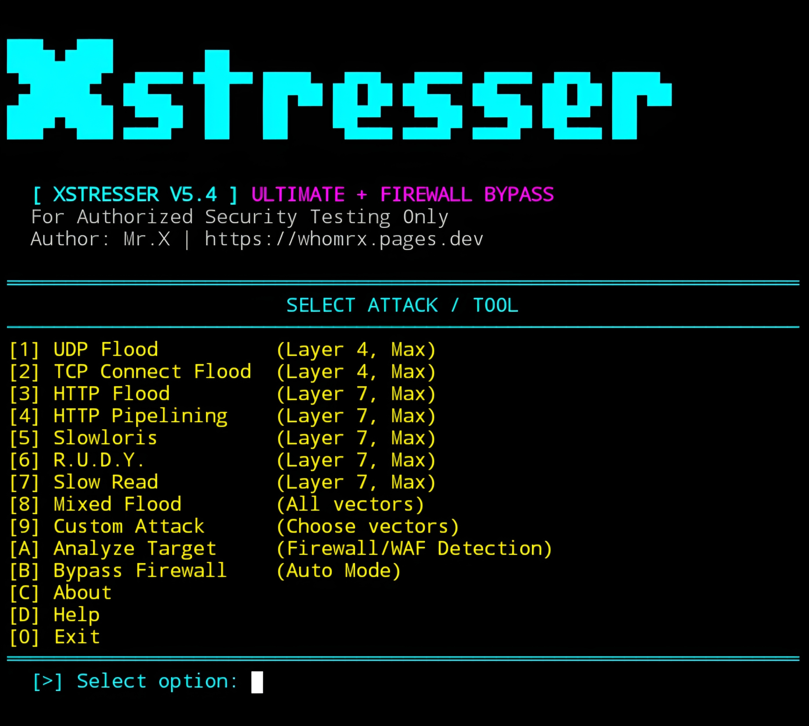

# XSTRESSER


<p align="center">
  <strong>Cyberpunk Network Stress Testing & Security Analysis Tool</strong><br>
  <em>"Test responsibly. Stay safe. Stay legal." – Mr.X</em>
</p>

## Introduction
XSTRESSER v5.4 is a cyberpunk-themed network security testing **(DDOS attack)** and analysis tool written in Python. It provides a terminal-based interface with responsive borders, animated initialization, live packet/speed statistics, and a dual-display monitoring interface. The tool includes several **network stress-testing vectors**, target analysis capabilities, configurable execution parameters, and an optional firewall/WAF analysis mode.

`XSTRESSER` is designed for authorized security testing, laboratory environments, and systems owned or explicitly permitted to be tested. It features a neon ANSI color scheme, live speed graphs, and multiple testing modes including UDP, TCP, HTTP, Slowloris, and more.

> **Important:** Network stress-testing functionality can disrupt services, overload systems, or cause resource exhaustion. Never use this tool against systems without explicit authorization.

## Installation
```bash
$ pkg update -y && pkg upgrade -y
$ pkg install python git -y
$ git clone https://github.com/Whomrx666/Xstresser.git
$ cd Xstresser
$ python3 install.py
```

## Run manually
```bash
$ python3 xstresser.py
```

## Features
- **Cyberpunk Terminal UI** – Neon ANSI colors with responsive borders and centered titles.
- **Multiple Testing Vectors** – Includes UDP, TCP, HTTP, pipelining, Slowloris, R.U.D.Y., Slow Read, and Mixed Flood.
- **Live Statistics & Graph** – Real-time packet-per-second visualization, bytes sent, connections, and elapsed time.
- **Target Analysis** – Checks connectivity, HTTP responses, headers, and WAF/CDN indicators (Cloudflare, Akamai, etc.).
- **Firewall/WAF Mode** – Automated firewall-evasion testing and indicator detection.
- **No-Flicker Display** – Uses cursor positioning to refresh the terminal interface smoothly.
- **Customizable Testing** – Configure header handling, randomized paths, HTTPS usage, and slow-mode behavior.
- **Animated Loading Screen** – Displays initialization stages and a progress animation.
- **Graceful Exit** – Dedicated exit screen and handles "Ctrl+C" interruptions safely.
- **Standard Library Based** – Uses  socket ,  threading ,  ssl ,  urllib.parse , and others without heavy external dependencies.

## Menu Options
| #  | Option | Description |
|----|--------|-------------|
| 1 | UDP Flood  | UDP-based network stress-testing vector |
| 2 | TCP Connect Flood | TCP connection stress-testing vector |
| 3 | HTTP Flood | HTTP request stress-testing vector |
| 4 | HTTP Pipelining | Multiple HTTP requests over connections |
| 5 | Slowloris | Slow HTTP connection testing |
| 6 | R.U.D.Y. | Slow POST testing vector |
| 7 | Slow Read | Slow response-reading test |
| 8 | Mixed Flood | Combination of multiple vectors |
| 9 | Custom Attack | Select specific testing vectors |
| A | Analyze Target | Analyze HTTP/WAF/CDN indicators and connectivity |
| B | Bypass Firewall | Automated firewall-evasion testing mode |
| C | About | Display tool and author information |
| D | Help | Display usage information |
| 0 | Exit | Close XSTRESSER |


## Instructions
1. **Install** – the tool using the commands above.
2. **Run** – `python3 xstresser.py`  to enter the interactive menu.
3. **Read Legal Warning** – Confirm authorization before continuing.
4. **Select Mode** – Choose a testing vector (Options 1-9) or Analysis mode (Option A/B).
5. **Configure Parameters** – Set target IP/Domain and specific test parameters if prompted.
6. **Monitor Live Stats** – Watch the real-time speed graph and packet statistics.
7. **Interrupt** – Press  Ctrl+C  to stop an ongoing test immediately.
8. **Exit** – Use Option 0 or press Ctrl+C at the main menu to quit.

## Observation
This project is intended for **authorized security testing and educational purposes only**.

### Original Author
<a href="https://github.com/Whomrx666"></a>

### <<< If you copy, then give me the credits >>>

## CONNECT WITH ME :

[](https://whomrx.pages.dev) <br>
[](https://whomrxhackers.blogspot.com) <br>
[](https://twitter.com/whomrx666) <br>
[](https://wa.me/6285926601133?text=Halo%2C%20Mr.X) <br>
[](https://www.facebook.com/whomrx.666) <br>
[](https://t.me/Whomr_X) <br>
[](mailto:whomrx666@gmail.com) <br>
[](https://www.tiktok.com/@whomr.x)

**If you want to donate, click on the button**
<a href="https://saweria.co/whomrx"></a>

---

<p align="left">
  
</p>